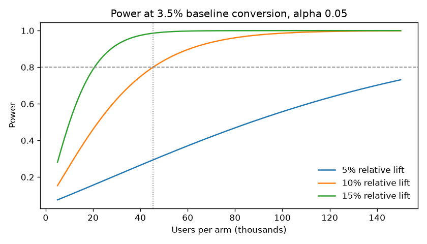
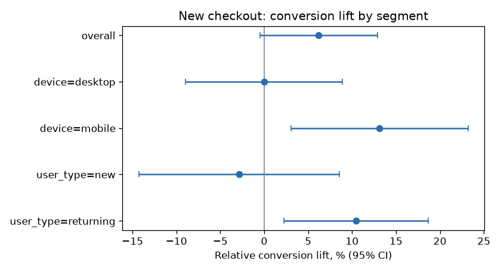
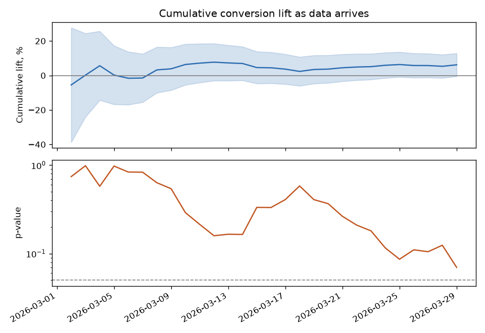

# A/B Test Analysis: One-Page Checkout

A full experiment readout, from the sample-size plan to a ship/no-ship memo: validity checks, a two-proportion test on conversion, revenue tests with a bootstrap interval, and segment cuts corrected for multiple testing.

**Scenario:** an online store tests a one-page checkout (treatment) against its three-step checkout (control). Users are split 50/50 on their first visit. The data is synthetic and seeded (`data/generate.py` documents the simulated behaviour), so the run is reproducible and the analysis can be checked against a known ground truth.

## 1. Plan

Before launch: baseline conversion 3.5%, smallest lift worth shipping 10% (relative), alpha 0.05, power 80%. That needs **45,338 users per arm**. At 3,500 users a day that is 26 days, rounded up to 28 so every weekday appears equally often in both arms.

| Relative lift to detect | Users per arm | Days at current traffic |
|---|---|---|
| 5% | 177,265 | 101 |
| 10% | 45,338 | 26 |
| 15% | 20,598 | 12 |
| 20% | 11,836 | 7 |



## 2. Validity checks

97,867 users, 2026-03-02 to 2026-03-29.

- Sample ratio: 49,082 control vs 48,785 treatment (50.2% control), chi-square p = 0.34: no sample ratio mismatch.
- Covariate balance across arms: device p = 0.26, user_type p = 0.38 (randomization looks clean).
- Sample: planned 45,338 users per arm over 28 days; got 48,785 per arm over 28 days.

## 3. Results

| Metric | Control | Treatment | Relative change | 95% CI | p-value |
|---|---|---|---|---|---|
| Conversion (primary) | 3.49% | 3.71% | +6.2% | -0.5% to +12.9% | 0.070 |
| Revenue per user | $2.14 | $2.18 | +2.1% | -$0.12 to +$0.20 (bootstrap, absolute) | 0.584 |
| Order value (buyers) | $61.15 | $58.83 | -3.8% | | 0.057 |

Conversion: two-proportion z-test, Newcombe interval. Revenue per user: Welch t-test and a 2,000-resample bootstrap interval (most users spend zero, so the bootstrap is the safer interval). Order value: Welch t-test on buyers.

### Segments

| Segment | Users | Control | Treatment | Lift | 95% CI | p | p (Holm) |
|---|---|---|---|---|---|---|---|
| device=desktop | 41,248 | 4.48% | 4.48% | -0.0% | -8.9% to +8.9% | 0.995 | 1.000 |
| device=mobile | 56,619 | 2.78% | 3.15% | +13.1% | +3.1% to +23.2% | 0.010 | 0.042 |
| user_type=new | 43,912 | 2.58% | 2.51% | -2.8% | -14.3% to +8.6% | 0.625 | 1.000 |
| user_type=returning | 53,955 | 4.24% | 4.68% | +10.4% | +2.2% to +18.7% | 0.013 | 0.042 |



## 4. Decision memo

**Decision: do not ship.**

- Conversion moved +6.2% (95% CI -0.5% to +12.9%, p = 0.070): not significant at alpha 0.05.
- Revenue per user moved +2.1% (p = 0.58), not significant. Order value among buyers moved -3.8% (p = 0.057), so part of any conversion gain is offset by smaller baskets.
- Segments that hold up after the Holm correction: device=mobile (+13.1%, Holm p = 0.042), user_type=returning (+10.4%, Holm p = 0.042). The rest are flat.
- Next: segment results were not the pre-registered primary metric, so treat them as a lead, not a result. Run a follow-up test of the new checkout on mobile only, with conversion as the primary metric and order value as a guardrail.

## Why the test is read once

Read daily, the cumulative test crossed p < 0.05 on 0 of 28 days (lowest p on day 28). The interval narrows steadily as data arrives; the readout uses only the planned end date.



## How it works

```
data/generate.py     seeded synthetic experiment, one row per user (output not committed)
src/power.py         sample size and run length; results/plan.json, power_curve.png
src/analyze.py       checks, tests, segments, daily cumulative readout; results/metrics.json
src/report.py        render this README from results/metrics.json
notebooks/01_analysis.ipynb   the same analysis step by step
```

## Run it

```bash
python -m venv .venv && source .venv/bin/activate
pip install -r requirements.txt
./run_all.sh
```

Under a minute. Every number above is read from `results/metrics.json`, which the run regenerates.
