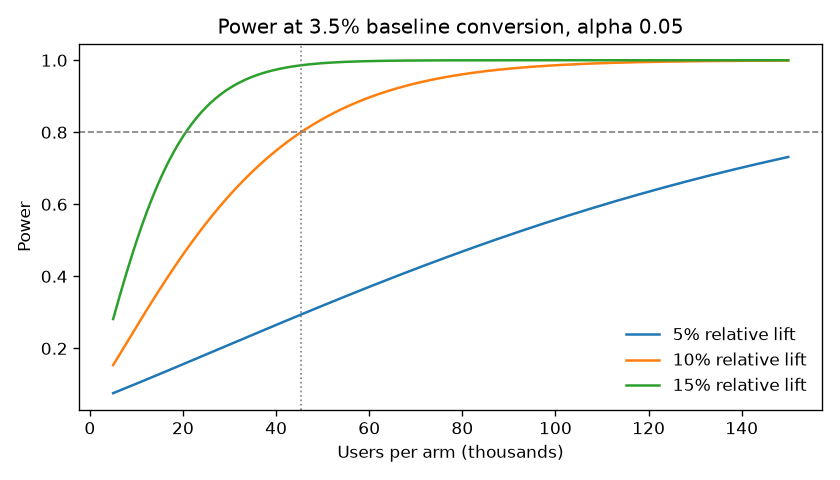
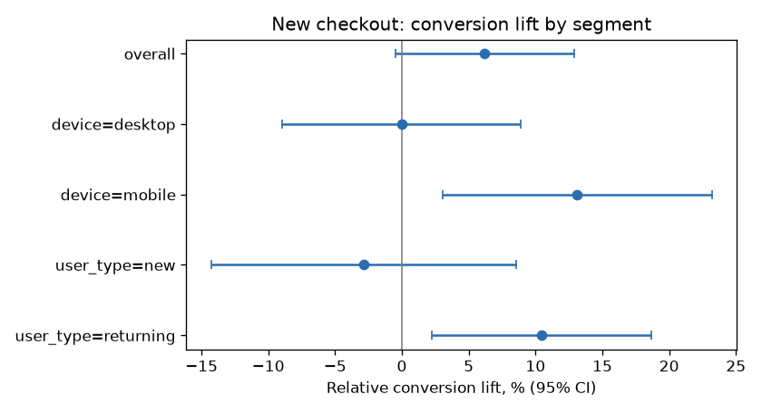
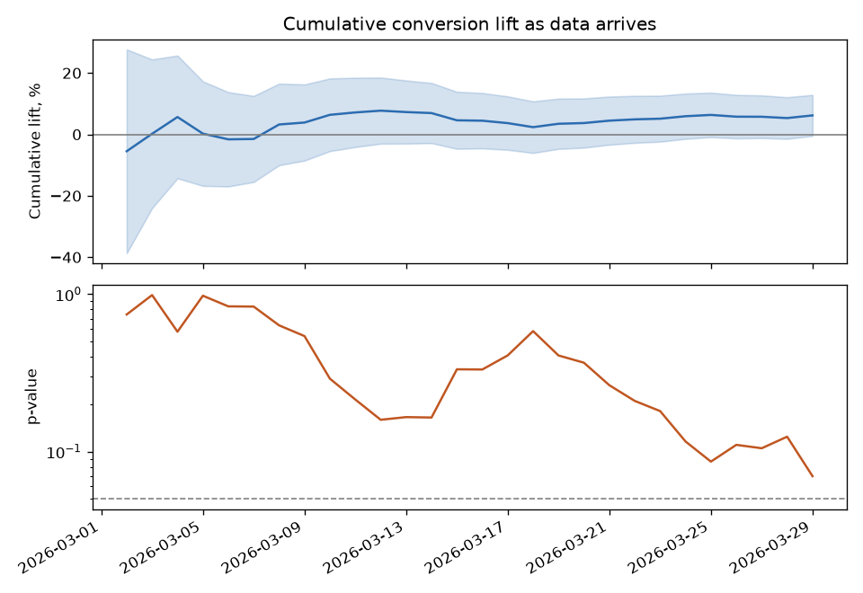

# A/B Test Analysis: One-Page Checkout

A full experiment readout, from the sample-size plan to a ship/no-ship memo: validity checks, a two-proportion test on conversion, revenue tests with a bootstrap interval, and segment cuts corrected for multiple testing.

**Scenario:** an online store tests a one-page checkout (treatment) against its three-step checkout (control). Users are split 50/50 on their first visit. The data is synthetic and seeded (`data/generate.py` documents the simulated behaviour), so the run is reproducible and the analysis can be checked against a known ground truth.

## 1. Plan

Before launch: baseline conversion {{BASELINE}}, smallest lift worth shipping {{MDE}} (relative), alpha {{ALPHA}}, power {{POWER}}. That needs **{{N_PLAN}} users per arm**. At {{DAILY}} users a day that is {{DAYS_NEEDED}} days, rounded up to {{DAYS_PLANNED}} so every weekday appears equally often in both arms.

| Relative lift to detect | Users per arm | Days at current traffic |
|---|---|---|
{{MDE_TABLE}}



## 2. Validity checks

{{USERS}} users, {{START}} to {{END}}.

{{CHECKS}}

## 3. Results

| Metric | Control | Treatment | Relative change | 95% CI | p-value |
|---|---|---|---|---|---|
{{METRICS}}

Conversion: two-proportion z-test, Newcombe interval. Revenue per user: Welch t-test and a 2,000-resample bootstrap interval (most users spend zero, so the bootstrap is the safer interval). Order value: Welch t-test on buyers.

### Segments

| Segment | Users | Control | Treatment | Lift | 95% CI | p | p (Holm) |
|---|---|---|---|---|---|---|---|
{{SEGMENTS}}



## 4. Decision memo

{{MEMO}}

## Why the test is read once

{{PEEKING}}



## How it works

```
data/generate.py     seeded synthetic experiment, one row per user (output not committed)
src/power.py         sample size and run length; results/plan.json, power_curve.png
src/analyze.py       checks, tests, segments, daily cumulative readout; results/metrics.json
src/report.py        render this README from results/metrics.json
notebooks/01_analysis.ipynb   the same analysis step by step
```

## Run it

```bash
python -m venv .venv && source .venv/bin/activate
pip install -r requirements.txt
./run_all.sh
```

Under a minute. Every number above is read from `results/metrics.json`, which the run regenerates.
